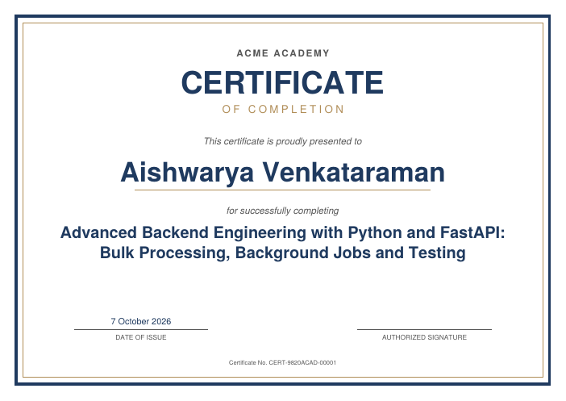

# Bulk Certificate Generator API

A FastAPI backend that accepts **a list of recipients in one request**, generates a PDF certificate
for each valid recipient from a single predefined template, tracks progress per job, and lets the
client retrieve certificates individually or as one zip.



## Setup

Requires Python 3.10+.

```bash
python -m venv .venv && source .venv/bin/activate
pip install -r requirements.txt
```

## Run

```bash
uvicorn app.main:app --reload        # http://localhost:8000  (interactive docs at /docs)
```

or with Docker:

```bash
docker build -t cert-api . && docker run -p 8000:8000 -v cert-data:/srv/storage cert-api
```

Configuration (all optional, `CERT_*` environment variables or `.env`):

| Variable | Default | Meaning |
|---|---|---|
| `CERT_DATABASE_URL` | `sqlite:///./certs.db` | Any SQLAlchemy URL, e.g. PostgreSQL |
| `CERT_STORAGE_DIR` | `./storage` | Where generated PDFs are written |
| `CERT_MAX_RECIPIENTS_PER_JOB` | `10000` | Upper bound per request |

## Run tests

```bash
pip install -r requirements-dev.txt
pytest
```

The suite (28 tests) covers job creation, validation, PDF content, progress while processing,
per-certificate failure isolation, retrieval (single PDF, listing, zip) and crash recovery.

## Submit a request

```bash
curl -X POST http://localhost:8000/api/jobs/ \
  -H "Content-Type: application/json" -d @samples/request.json
```

```json
{
  "course_name": "Introduction to Python",
  "organization": "Acme Academy",
  "issue_date": "2026-10-07",
  "recipients": [
    {"name": "Asha Rao", "email": "asha@example.com"},
    {"name": "Ben Carter"},
    {"name": ""}
  ]
}
```

| Field | Rules |
|---|---|
| `course_name` | required, ≤150 chars |
| `organization` | optional, ≤100 chars |
| `issue_date` | optional ISO date, defaults to today |
| `recipients[].name` | required, ≤80 chars, no control characters, Latin-1/Windows-1252 characters only |
| `recipients[].email` | optional, must look like an address |

Response `202 Accepted` (work continues in the background):

```json
{
  "id": "622c853d5bca4354a9605c922b2dded7",
  "status": "PENDING",
  "progress": {"total": 3, "pending": 2, "generated": 0, "failed": 1, "percent_complete": 33.3},
  "links": {"self": "/api/jobs/622c.../", "certificates": "/api/jobs/622c.../certificates/", "download_zip": "/api/jobs/622c.../download/"},
  "...": "..."
}
```

### Check progress

`GET /api/jobs/{id}/`

```json
{
  "id": "622c853d5bca4354a9605c922b2dded7",
  "status": "COMPLETED_WITH_ERRORS",
  "progress": {"total": 5, "pending": 0, "generated": 3, "failed": 2, "percent_complete": 100.0},
  "failures": [
    {"index": 3, "recipient_name": "", "error": "Validation failed: name must not be empty"},
    {"index": 4, "recipient_name": "Divya Nair", "error": "Validation failed: email is not a valid address"}
  ],
  "failures_truncated": false,
  "started_at": "2026-10-07T09:40:39.654238Z",
  "finished_at": "2026-10-07T09:40:39.719806Z"
}
```

Job `status`: `PENDING` → `PROCESSING` → `COMPLETED` (all generated) · `COMPLETED_WITH_ERRORS`
(some failed) · `FAILED` (none generated). `index` is the position in the request's `recipients` array.
`failures` lists up to 100 entries; use the listing endpoint below for everything.

## Retrieve certificates

| Endpoint | Description |
|---|---|
| `GET /api/jobs/{id}/certificates/?status=GENERATED\|FAILED\|PENDING&limit=100&offset=0` | Per-certificate status, error and `download_url` |
| `GET /api/certificates/{certificate_id}/` | One PDF (`application/pdf`) |
| `GET /api/jobs/{id}/download/` | Zip of all generated PDFs (once the job has finished) |

```bash
curl -o certificates.zip http://localhost:8000/api/jobs/<job_id>/download/
curl -o asha.pdf        http://localhost:8000/api/certificates/<certificate_id>/
```

Errors: `422` invalid request (job-level fields, or **no** valid recipient), `404` unknown id,
`409` job not finished yet / certificate has no file, `410` file missing on disk.

## Design decisions

**Processing model: background task, in-process.**
`POST` validates and stores the request, returns `202` immediately, and a FastAPI background task
generates the certificates after the response is sent. Alternatives considered:
- *Synchronous* – simplest, but a 5,000-recipient request would hold the HTTP connection for tens of
  seconds and hit client/proxy timeouts. Rejected, since the problem is explicitly about bulk work.
- *Celery/RQ + Redis* – the right answer at scale (multiple workers, retries, durability), but adds
  infrastructure that isn't justified for this scope. The processing function `process_job(job_id)`
  takes only an id and reads everything from the database, so moving it into a Celery task is a
  one-line change.
- Measured here: 1,000 certificates finish in ~4 s, and the `POST` returns in ~0.1 s.

**Validation is per recipient, not per request.** Job-level fields are validated strictly (`422`).
Each recipient is validated on its own: invalid ones are stored as `FAILED` with the reason, valid
ones are generated. Only if *every* recipient is invalid is the request rejected (`422` with
per-recipient errors). This meets "one bad row must not block the rest" and still tells the client exactly which rows failed.

**Failure isolation.** Every certificate is rendered inside its own `try/except` and committed
separately. A failure records the error on that certificate and the loop continues. The job
ends `COMPLETED_WITH_ERRORS` (or `FAILED` if nothing succeeded). Text that cannot fit the template
(e.g. an 80-character name of wide letters) fails cleanly for that certificate only.

**Progress is derived, not stored.** Counts come from a `GROUP BY status` query, so they can never
drift from the real certificate states. Because each certificate is committed as it finishes, a poll
during processing sees live progress.

**Crash safety.** Processing only touches `PENDING` certificates and claims the job with an atomic
`UPDATE ... WHERE status='PENDING'`, so re-running is idempotent and two runs can't overlap. On startup
jobs left in `PROCESSING` are reset to `PENDING` and resumed.
*Limitation:* this assumes a single application process (run uvicorn with one worker, as the
Dockerfile does). Multiple workers need a real queue (see Future scope).

**PDF generation.** `reportlab` draws one predefined A4-landscape template (`app/services/pdf.py`).
It is pure Python (no system dependencies) and fast. The recipient name auto-shrinks to fit, long
course names wrap. Built-in PDF fonts only support Windows-1252 characters, so other scripts are
rejected during validation with a clear message instead of rendering broken glyphs.

**Storage.** PDFs are written atomically (temp file + rename) under `storage/<job_id>/<certificate_id>.pdf`;
the database stores only the relative path, resolved with a check that it cannot escape the storage
directory. `app/services/storage.py` is the single place to swap for S3/GCS.

**Database.** SQLite by default (zero setup), any SQLAlchemy URL works (e.g. PostgreSQL). Tables: `jobs`,
`certificates` (indexed by `job_id` and `(job_id, status)`).

**IDs and numbers.** Opaque UUIDs in URLs; human-readable certificate numbers like `CERT-622C853D-00001`
are printed on each certificate.

## Future scope

- Celery/RQ worker pool (parallel rendering, retries with backoff, multi-process safe) and a
  `POST /jobs/{id}/retry` endpoint for failed certificates.
- Object storage (S3) with signed download URLs; retention/cleanup of old jobs.
- Unicode fonts (e.g. embedding Noto) so names in any script can be rendered.
- Email delivery of certificates to `recipients[].email`; webhook on job completion.
- Authentication, per-client rate limiting, idempotency keys for `POST`, duplicate-recipient detection.
- Alembic migrations, structured logging/metrics, CI.
